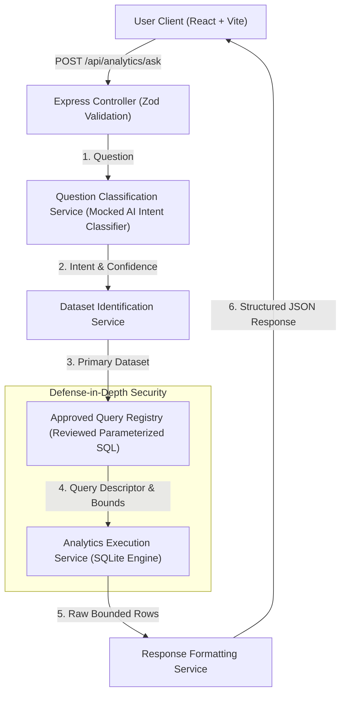
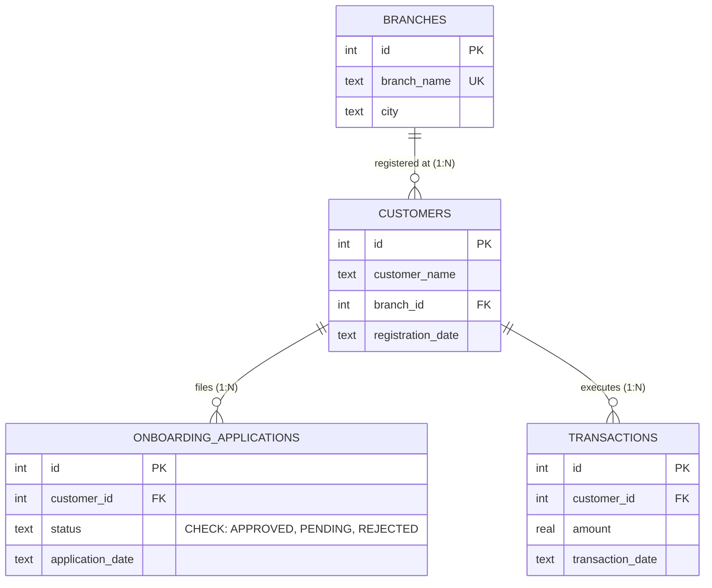

# Conversational Banking Data Analyst

An enterprise-grade, full-stack conversational banking data analytics platform built with **React, Vite, TypeScript, Express, and SQLite**. The system empowers business stakeholders and compliance officers to query banking data using natural language, executing **only human-reviewed, parameterized queries** through an approved query registry with zero risk of unrestricted AI-generated SQL execution.

---

## 1. Project Overview

The **Conversational Banking Data Analyst (CBDA)** is designed for financial institutions requiring strict query governance and auditability. Instead of permitting an LLM to generate raw, unvalidated SQL statements directly against a production database, the application decouples natural language processing from database execution:

1. Natural language questions are parsed and classified into vetted analytical intents.
2. The identified intent is mapped to pre-reviewed, parameterized SQL statements stored in an **Approved Query Registry**.
3. Results are bounded by safety limits, aggregated, formatted into natural language responses, and paired with dynamically selected visualizations (KPI metrics, sortable tables, and Recharts bar/line/pie charts).

---

## 2. Architecture & Modular Services

The backend is structured into five modular, decoupled services:



### Backend Modular Services (`backend/src/services/`):
1. **Question Classification Service** (`classification.service.ts`):
   - Simulates AI semantic intent classification using regex patterns, keyword scoring, and confidence thresholds (>= 0.60).
   - Maps natural language inputs into one of 6 supported analytical intents, or flags out-of-scope inquiries for HTTP 422 recovery.
2. **Dataset Identification Service** (`dataset.service.ts`):
   - Resolves the target database entity (`customers`, `onboarding_applications`, `branches, customers`, `transactions`) associated with the intent.
3. **Approved Query Registry** (`queryRegistry.service.ts`):
   - Maintains vetted, static SQL queries with parameterized placeholders (`?`).
   - Guarantees **no raw, dynamic, or unreviewed SQL is ever constructed or executed**.
4. **Analytics Execution Service** (`execution.service.ts`):
   - Executes queries against SQLite with enforced safety limits (`maxLimit`) and execution timing.
   - Logs execution duration, row counts, and intent **without logging sensitive customer PII or banking credentials**.
5. **Response Formatting Service** (`formatting.service.ts`):
   - Synthesizes user-friendly narrative answers with banking domain formatting (e.g., currency formatting, percentage breakdowns).
   - Assigns dynamic visualization directives (`kpi`, `table`, `bar`, `line`, `pie`).

---

## 3. Technology Stack

| Layer | Technologies | Key Capabilities |
|:---|:---|:---|
| **Frontend** | React 18, Vite 5, TypeScript 5 (Strict) | Component architecture, fast HMR, strict type safety |
| **Visualizations** | Recharts 2.12 | Responsive Bar, Line, and Donut charts |
| **Validation** | Zod 3.23 | Schema validation for API payloads, query parameters, and env config |
| **Backend** | Node.js 24, Express 4.21, TypeScript 5 (Strict) | REST API, modular service architecture |
| **Database** | SQLite 3 (Node.js Native `node:sqlite`) | ACID compliance, WAL journal mode, Foreign Key constraints |
| **Testing** | Vitest 2.1, JSDOM, Supertest | Fast unit, integration, and component test execution |

---

## 4. Database Schema & Relationships

The database is defined in `backend/src/database/scheme.sql` and enforces strict referential integrity (`PRAGMA foreign_keys = ON;`).



### Relational Constraints & Indexes:
- **Foreign Keys**:
  - `customers.branch_id` -> `branches.id` (`ON DELETE RESTRICT`)
  - `onboarding_applications.customer_id` -> `customers.id` (`ON DELETE CASCADE`)
  - `transactions.customer_id` -> `customers.id` (`ON DELETE CASCADE`)
- **Check Constraints**: `onboarding_applications.status IN ('APPROVED', 'PENDING', 'REJECTED')`
- **Unique Constraints for Idempotency**:
  - `branches(branch_name)`
  - `customers(customer_name, branch_id)`
  - `onboarding_applications(customer_id, application_date, status)`
  - `transactions(customer_id, amount, transaction_date)`
- **Covering Indexes**:
  - `idx_customers_branch_id`
  - `idx_applications_customer_id`
  - `idx_applications_status`
  - `idx_transactions_customer_id`
  - `idx_transactions_date`

---

## 5. Supported Analytical Questions

The platform supports six core financial analytics inquiries:

| Intent | Primary Dataset | Example Natural Language Questions | Visualization |
|:---|:---|:---|:---|
| `customer_count` | `customers` | "How many customers do we have?", "Count of customers", "Total customers" | `kpi` |
| `pending_applications` | `onboarding_applications` | "Show pending onboarding applications", "List pending files", "Which applications are pending?" | `table` |
| `application_status` | `onboarding_applications` | "Show applications by status", "Application status breakdown", "Status of onboarding applications" | `pie` |
| `branch_customers` | `branches, customers` | "Which branches have the most customers?", "Customers by branch", "Top branches" | `bar` |
| `total_transactions` | `transactions` | "What is the total transaction amount?", "Total transaction volume", "Sum of all transactions" | `kpi` |
| `monthly_transactions` | `transactions` | "Show monthly transaction trends", "Transactions across multiple months", "Transactions by month" | `bar` / `line` |

---

## 6. AI Intent Classification Approach

Natural language input is classified deterministically through a simulated AI intent pipeline:
1. **Sanitization**: Input is trimmed, stripped of punctuation, and lowercased.
2. **Regex Pattern Matching**: High-confidence patterns (0.98 confidence) match standard inquiry phrasings.
3. **Keyword Density Scoring**: Secondary semantic scoring matches domain keywords (threshold >= 0.60).
4. **Out-of-Scope Handling**: Unmatched questions return `null`, prompting an `HTTP 422 Unprocessable Entity` with recommended questions.

---

## 7. Safe SQL Execution Design

To prevent SQL injection and data exfiltration:
- **Zero Raw AI SQL**: SQL queries are never generated dynamically by an LLM.
- **Approved Query Registry**: All SQL commands are static strings defined in source code and reviewed by engineering.
- **Strict Parameterization**: Dynamic values are supplied strictly through parameterized queries (`?`).
- **Result Set Limits**: All queries include hard `LIMIT` clauses or server-side truncation (`maxLimit`).
- **Input Validation**: Request payloads are validated with Zod (1 to 500 characters, JSON only).
- **Request Size Limiting**: Express JSON parser is restricted to `100kb`.
- **Sanitized Logging**: Query logs record intent and duration; sensitive row contents are omitted.

---

## 8. Frontend & Backend Setup

### Prerequisites
- Node.js >= 20.0.0 (Tested on Node.js v24.15.0)
- npm >= 10.0.0

### Directory Structure
```text
conversational-banking-data-analyst/
├── .env.example                       # Root environment variables template
├── .gitignore                         # Excludes node_modules, .env, and *.db
├── .ignore                            # Search and repository hygiene
├── package.json                       # Orchestration scripts
├── scripts/
│   └── verify-integration.cjs         # End-to-end integration test runner
├── backend/
│   ├── .env.example                   # Backend secret template
│   ├── package.json                   # Backend dependencies & scripts
│   ├── tsconfig.json                  # Strict TypeScript configuration
│   ├── vitest.config.ts               # Backend Vitest configuration
│   ├── tests/                         # Automated unit & integration tests
│   └── src/
│       ├── app.ts                     # Express setup, CORS & routes
│       ├── index.ts                   # Server entrypoint
│       ├── database/                  # scheme.sql, seed.cjs, verify.cjs
│       ├── routes/                    # REST route controllers
│       ├── services/                  # 5 modular services
│       ├── validators/                # Zod validation schemas
│       └── types/                     # TypeScript interfaces
└── frontend/
    ├── package.json                   # Frontend dependencies & scripts
    ├── tsconfig.json                  # Strict TypeScript configuration
    ├── vite.config.ts                 # Bundler & proxy configuration
    ├── vitest.config.ts               # Frontend Vitest & JSDOM config
    └── src/
        ├── components/                # 10 UI components (Header, Chat, Charts, Tables)
        ├── services/                  # Frontend API client
        ├── types/                     # Strict frontend interfaces
        └── tests/                     # Frontend UI & interaction tests
```

---

## 9. Environment Variables

Create `.env` in the `backend/` directory (or use `.env.example` as a template):

| Variable | Description | Default / Example | Sensitive? |
|:---|:---|:---|:---|
| `PORT` | Backend HTTP listening port | `5000` | No |
| `NODE_ENV` | Environment mode | `development` | No |
| `API_PREFIX` | Base API routing prefix | `/api` | No |
| `CORS_ORIGIN` | Allowed client origin for CORS | `http://localhost:5173` | No |
| `DB_FILE` | SQLite database file path | `./src/database/banking.db` | No |
| `DB_PASSWORD` | Database access / encryption password | `mock_secure_password_example` | **Yes (Keep Secret)** |
| `DB_ENCRYPTION_KEY`| 32-character AES database key | `mock_32_char_encryption_key!` | **Yes (Keep Secret)** |
| `JWT_SECRET` | Secret token for signed sessions | `mock_jwt_secret_token_example` | **Yes (Keep Secret)** |
| `SESSION_SECRET` | Secret token for session cookies | `mock_session_secret_example` | **Yes (Keep Secret)** |

> **Security Guarantee**: Real credentials and database files (`*.db`) are excluded from Git via `.gitignore`.

---

## 10. How to Seed the Database

The database seed script inserts **83 synthetic records** across 4 tables with multi-month transactions and varied application statuses:

```powershell
# From the repository root:
npm run db:seed

# Or from the backend directory:
cd backend
npm run db:seed
```

### Verify Database Integrity & Constraints:
```powershell
npm run db:verify
```
The verification script confirms:
- `PRAGMA foreign_keys = 1` (Active)
- 0 foreign key violations (`PRAGMA foreign_key_check`)
- Check constraints reject invalid statuses
- Seeding is **100% idempotent** (re-running produces 0 duplicate records)

---

## 11. How to Run the Application

### Development Mode (Concurrent)

Run backend and frontend in separate terminals:

**Terminal 1 — Backend (`http://localhost:5000`)**:
```powershell
cd backend
npm run dev
```

**Terminal 2 — Frontend (`http://localhost:5173`)**:
```powershell
cd frontend
npm run dev
```

Access the dashboard at **`http://localhost:5173`**.

### Production Build & Preview
```powershell
# Compile backend
cd backend
npm run build
npm start

# Compile frontend
cd frontend
npm run build
npm run preview
```

---

## 12. How to Run Tests

### Run All Automated Tests (Backend + Frontend)
```powershell
npm test
```

### Run Backend Tests Only (59 Tests)
```powershell
cd backend
npm run test
```
- `tests/classification.test.ts`: Intent variations, keyword density, unsupported queries, SQL injection detection.
- `tests/analytics.test.ts`: All 6 supported API endpoints, HTTP 400 validation, HTTP 422 error handling, health endpoint.
- `tests/banking.test.ts`: SQLite schema integrity, foreign key rejection, CHECK constraint verification.

### Run Frontend Tests Only (9 Tests)
```powershell
cd frontend
npm run test
```
- `src/tests/App.test.tsx`: Header rendering, suggested inquiries, empty input validation, KPI metrics, DataTable rendering, Recharts trend toggle, Copy Answer, and Copy Data functionality.

### Strict TypeScript Checks (Zero Errors)
```powershell
npm --prefix backend run typecheck
npm --prefix frontend run typecheck
```

---

## 13. Complete Functionality Checklist

- [x] **Conversational Chat Interface**: Clean white & slate grey design with responsive bubbles and auto-scrolling.
- [x] **Dynamic Visualizations**: Automatically selects KPI card, sortable DataTable, or Recharts Bar/Line/Donut charts based on backend response metadata.
- [x] **Data Exporting**: One-click **Copy Answer** and **Copy Raw Data (JSON)** with visual clipboard confirmation.
- [x] **Interactive Trend Controls**: Seamless toggle between Bar View and Line Trend on monthly transaction inquiries.
- [x] **Input Validation**: Client-side character counter (max 500), empty submission prevention, and server-side Zod schemas.
- [x] **Security Guardrails**: Parameterized queries only, no dynamic SQL execution, strict CORS enforcement, and request payload caps.

---

## 14. Assumptions

1. **Synthetic Data**: All data represents fictitious commercial and individual banking entities.
2. **Single Currency**: All financial figures are denominated in USD ($) and formatted with two decimal places.
3. **Date Format**: Standardized on ISO-8601 calendar strings (`YYYY-MM-DD`).
4. **Mocked AI Intent Classifier**: Demonstrates safe conversational query mapping deterministically without requiring third-party cloud API keys or incurring external latency.

---

## 15. Known Limitations

1. **SQLite Concurrency**: SQLite operates in single-writer mode. While WAL (Write-Ahead Logging) is enabled for fast concurrent reads, high-write production systems require a distributed RDBMS.
2. **Intent Scope**: Questions outside the 6 reviewed banking intents return HTTP 422 with suggested alternatives rather than dynamically formulating novel queries.

---

## 16. Productionisation Plan

To transition this platform to high-volume production:
1. **Database Migration**: Migrate from SQLite to **PostgreSQL** or **CockroachDB** with connection pooling (e.g., PgBouncer / Prisma).
2. **Managed LLM Integration**: Incorporate an enterprise LLM (e.g., Google Cloud Vertex AI / Gemini API) with **Function Calling / Tool Use**, constraining the model to output structured intent arguments rather than raw SQL.
3. **Caching Layer**: Deploy a **Redis** cluster to cache frequent analytical summaries (e.g., monthly volume aggregates) with cache invalidation on new transactions.
4. **Authentication & RBAC**: Implement OAuth2 / OIDC with fine-grained role-based access control (e.g., restricting transaction visibility by branch).
5. **Observability**: Integrate OpenTelemetry, Prometheus metrics, and structured JSON logging (Winston/Pino) for audit compliance.

---

## 17. AI Tool Disclosure

In accordance with transparent engineering practices, generative AI coding assistants were utilized during development for rapid scaffolding, drafting TypeScript interfaces, synthetic data generation, and test suite generation. All business logic, SQL schemas, security constraints, and UI components were reviewed and verified through automated test suites and live API execution.
